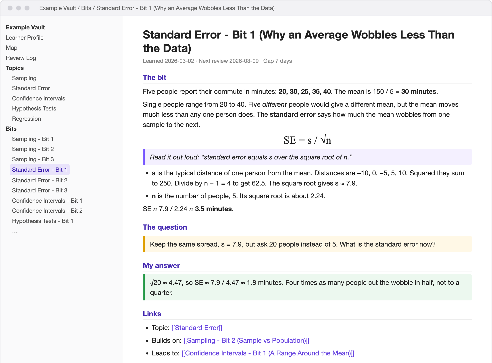
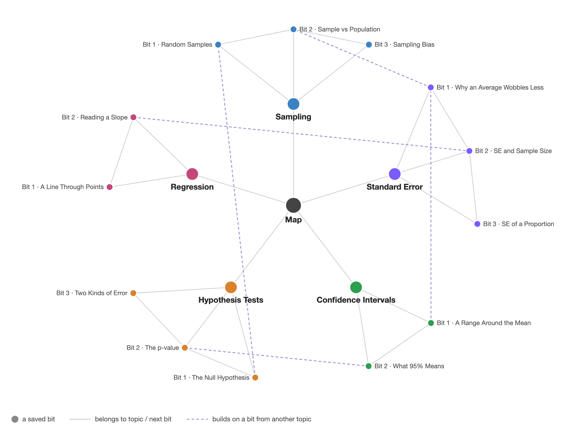

# teach-me

A skill that turns an AI assistant into a tutor that will not hand you the answer.

It teaches one small bit per turn, asks you one question, and waits. When you get
it right, it saves the bit as a linked note in an Obsidian vault. Later it brings
old bits back on a spaced schedule until you can recall them cold. The vault
becomes a readable record of what you actually understand, for you and for any
AI agent you work with.

Built for research: learning the one concept a paper needs, today, without
watching twenty hours of lectures first.

## Set up in one step

Paste this into Claude Code (or another AI coding agent with file access):

```
Clone https://github.com/TheMattViana/teach-me and follow SETUP.md in it to set up the teach-me skill for me.
```

The agent asks you four short questions, installs the skill, creates your vault,
and teaches you one bit as a test. It takes a few minutes.

## Use it

| You say | What happens |
|---|---|
| `teach me X`, or paste a paper and say `walk me through this` | One bit per turn, each ending in a question you answer |
| `next` | Moves on once the current bit holds |
| `quiz me` or `quiz me on X` | Questions drawn from your vault, weighted to what is due |
| Open the vault in [Obsidian](https://obsidian.md) and use graph view | A map of everything you have learned and how it connects |

## How a bit works

1. **A concrete example first.** A real case from your own source, worked step by step.
2. **Said out loud.** Every new symbol or term comes with how to read it.
3. **Shown.** A plot, diagram, or short code run when one helps.
4. **One question, then it stops.** You produce the answer.
5. **Saved only after you answer correctly**, with links to related bits.
6. **Brought back** after 1, 3, 7, 16, and 35 days. A miss resets the gap.

## What a vault looks like

Both pictures below are made-up examples on an introductory statistics topic.
They are illustrations, not screenshots of a real learner's vault.

**A saved bit.** The explanation, how to read the formula out loud, the
question, the learner's own answer, and links to related bits. The same bit as
a plain file is in [`examples/`](examples/).



**The vault as a map.** Each small dot is a saved bit and each large dot is a
topic. Dashed lines mark a bit that builds on a bit from another topic. In
Obsidian this is the graph view.



## What is in this repository

| File | What it is |
|---|---|
| `SKILL.md` | The rules the AI follows when teaching. Plain text. Edit it to fit how you learn. |
| `SETUP.md` | Step by step instructions the AI follows to install the skill and create your vault. |
| `vault-template/` | The empty vault: a learner profile, a topic map, a review log, and folders for bits. |
| `examples/` | A made-up example bit and the two pictures above. Not copied into your vault. |

## Make it yours

The skill is one text file. If a rule does not fit your field, change it. Tell
your agent, for example, "in my teach-me skill, use R for worked examples" or
"add a rule that every bit must cite the page it came from".

## Your notes stay with you

The vault is a folder of Markdown files on your own computer. Nothing in this
repository collects or uploads it.

## License

MIT. See `LICENSE`.
